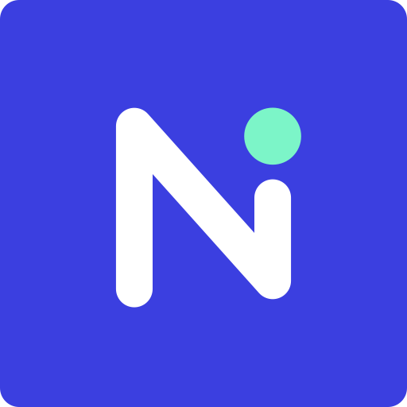

<h1 align="center">
  
  Notium
</h1>

<p align="center"><a href="README.md">English</a> | <strong>Español</strong></p>

App de notas Markdown local-first — **Fase 1 completada** (monorepo de producción, editor Markdown estilo Obsidian con vista previa en vivo, barra de formato, watcher, Android).

- **Framework:** Tauri 2 (Rust) + Svelte 5 / TypeScript
- **Núcleo:** `crates/notium-core` — vault sin interfaz, extractor de Markdown (`.md`), índice SQLite FTS5, primitivas de sincronización
- **Shell:** `src-tauri` — comandos IPC tipados (vault/notas/enlaces/búsqueda/ajustes)

## Requisitos

- Rust (toolchain MSVC en Windows)
- Node.js ≥ 20 y npm
- Android: JDK, Android SDK + NDK 28.2 (para el APK)

## Desarrollo (shell de escritorio)

```powershell
npm install          # una vez
npm run tauri dev    # arranca vite (puerto 1420) + la ventana de escritorio de Tauri
```

## Comprobaciones

```powershell
cargo test --release     # tests unitarios y de integración de Rust
npm run check            # svelte-check (0 errores / 0 avisos)
npm run build            # build de producción de vite (genera dist/)
```

## APK de Android (release)

```powershell
$env:ANDROID_HOME = "<ruta del Android SDK>"; $env:NDK_HOME = "$env:ANDROID_HOME\ndk\<versión del NDK>"
npm run tauri android build -- --apk --target aarch64 --ci
adb install -r "src-tauri\gen\android\app\build\outputs\apk\universal\release\app-universal-release.apk"
adb shell am start -n dev.notium.app/.MainActivity
```

Gradle firma el APK de release con `src-tauri/gen/android/keystore.properties`
(no versionado — créalo con `password`, `keyAlias` y `storeFile`; consulta la
[guía de firma de Android de Tauri](https://v2.tauri.app/distribute/sign/android/)).

## Funciones (Fase 1)

- **Editor `.md` estilo Obsidian** — CodeMirror 6 con Live Preview (oculta la sintaxis según la posición del cursor),
  modos de vista Fuente y Lectura, autocompletado de `[[Wiki Link]]` y navegación con clic.
- **Barra de formato** (escritorio y móvil) con tablas, tareas, enlaces, incrustaciones, etiquetas y adjuntos.
- **Paleta de búsqueda FTS** (Ctrl+K), **panel de backlinks** unificado, watcher del sistema de archivos, interfaz adaptable.
